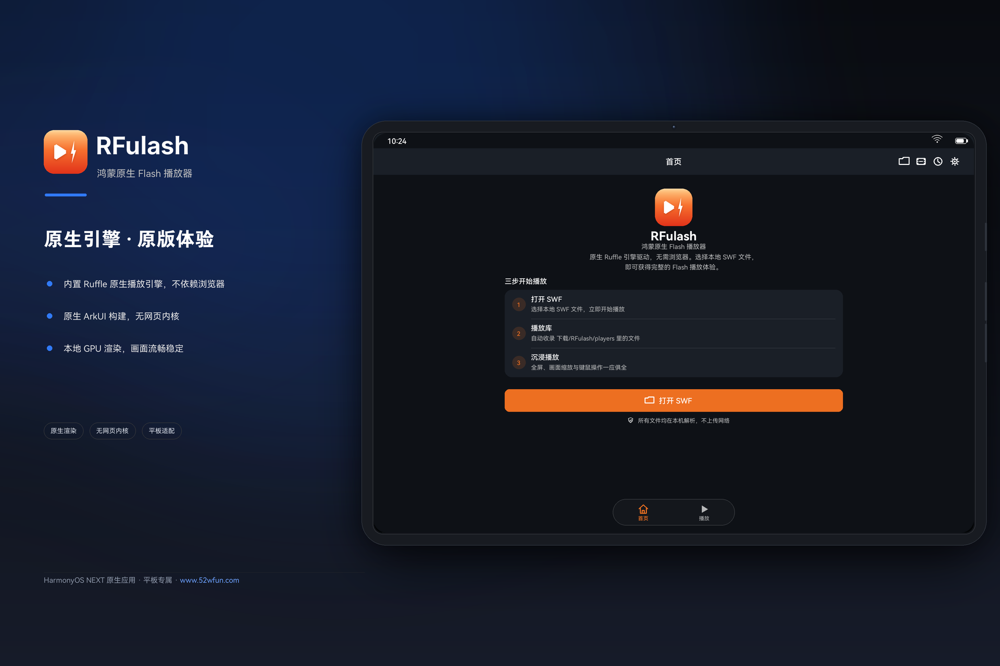
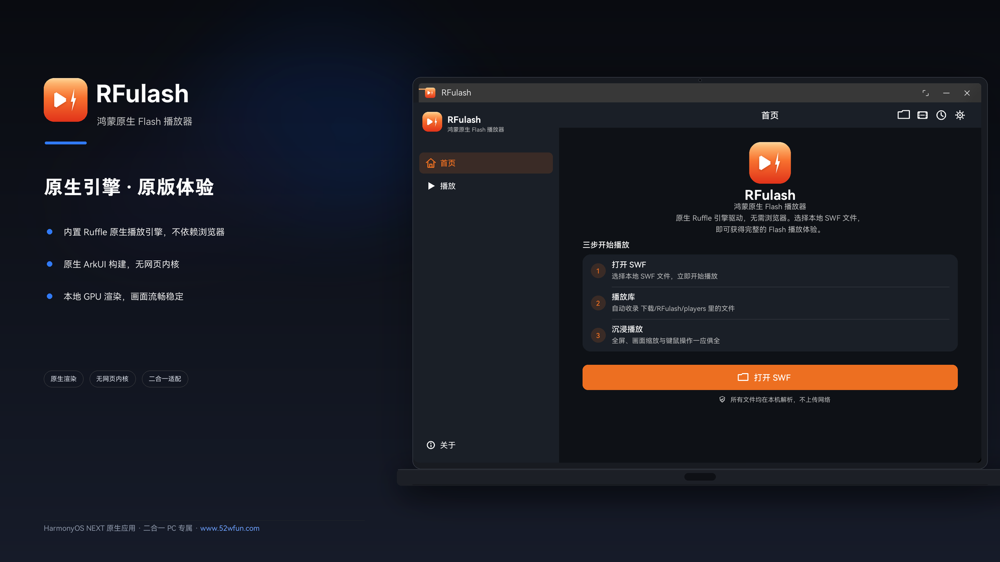

# RFulash

鸿蒙原生 Flash 播放器 · Ruffle 引擎移植 / Native Flash Player for HarmonyOS


RFulash 将 [Ruffle](https://github.com/ruffle-rs/ruffle)（Rust 实现的 Flash 模拟器）移植到 HarmonyOS NEXT，采用 ArkUI + XComponent（Surface）+ NAPI + EGL/GLES3 原生渲染，不依赖 WebView / ArkWeb。

## 功能

- 打开本地 SWF 文件或在线链接播放
- 播放库与最近打开记录，支持分组管理
- 全屏播放、画面缩放与键鼠操作
- 浅色/深色主题，跟随系统 / 简体中文 / 繁體中文 / English / 日本語 / 한국어 / Русский
- 平板、2in1 自适应布局

| 平板 | 电脑 |
| --- | --- |
|  |  |

## 环境

- HarmonyOS 6.0 及以上，API 26（`compatibleSdkVersion 26.0.0`）
- DevEco Studio 6.0 及以上
- 引擎为预编译库 `entry/libs/arm64-v8a/libruffle_ohos_engine.so`，基于 Ruffle 0.7.1 修改

## 构建

1. 复制 `build-profile.sample.json5` 为 `build-profile.json5`，在 DevEco Studio 中配置本地签名（`build-profile.json5` 已被 `.gitignore` 排除，避免提交签名口令与证书路径）；
2. 使用 DevEco Studio 打开工程构建，或执行：

```sh
hvigorw assembleHap --mode module -p product=default -p module=entry@default -p buildMode=debug
```

## 目录

- `entry/` — HarmonyOS 应用（ArkTS UI、C++ NAPI 桥接）
- `tools/` — 商店截图、宣传图与多语言资源生成脚本
- `store/` — 应用图标与商店宣传图

## 开源许可

RFulash 以 MIT 许可证开源，全文见 [LICENSE](LICENSE)。

| 项目 | 角色 | 许可证 | 地址 |
| --- | --- | --- | --- |
| RFulash | 本项目 | MIT | https://github.com/IChuJianI/RFulash |
| Ruffle | Flash 引擎 | MIT OR Apache-2.0 | https://github.com/ruffle-rs/ruffle |

上游 Ruffle 的完整 MIT / Apache-2.0 许可全文与第三方组件清单见 [Ruffle_LICENSE.md](Ruffle_LICENSE.md)；端口新增组件见 [RFulash_THIRD_PARTY_NOTICES.md](RFulash_THIRD_PARTY_NOTICES.md)。应用内「关于 → 开源许可」提供同样内容。

Ruffle 及所有第三方组件的版权归其各自作者所有。

## 作者

李晨 · 3093376617@qq.com
